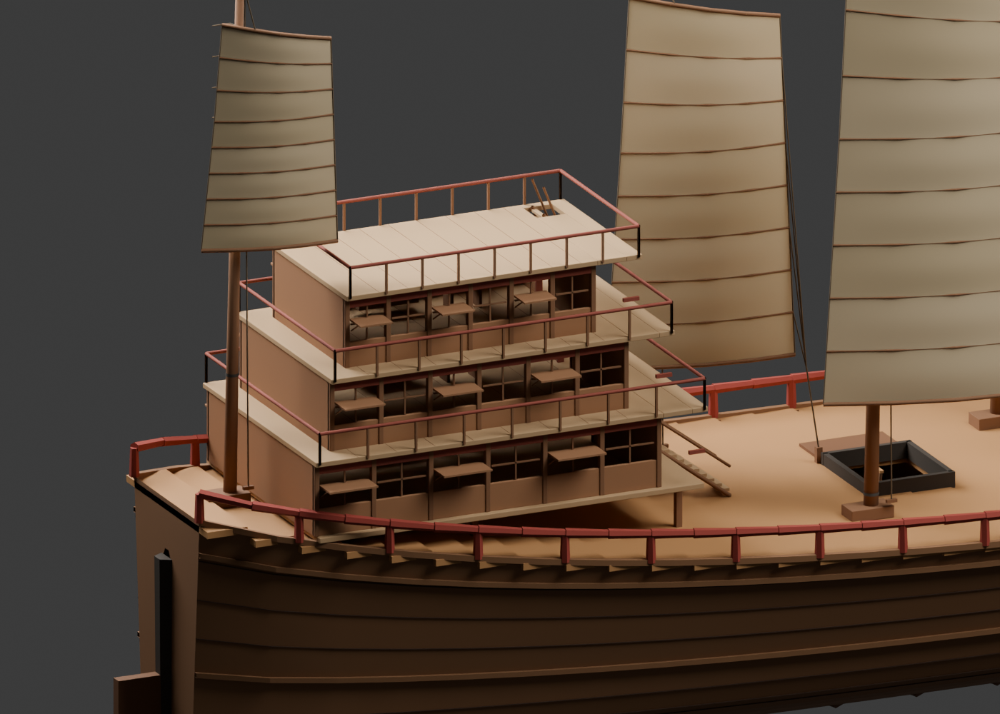
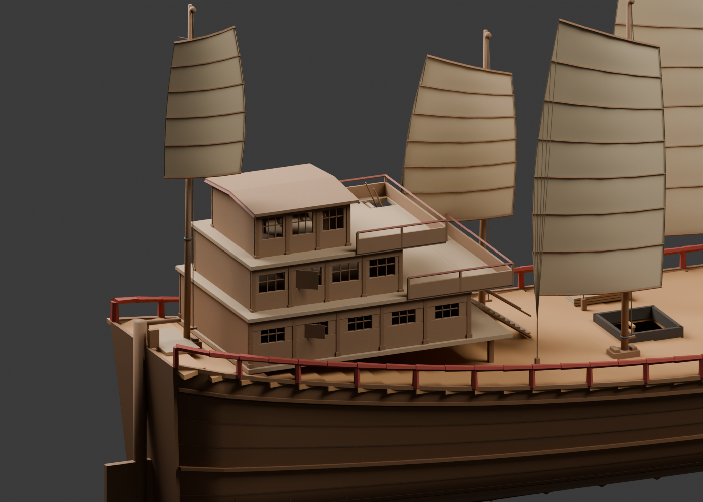
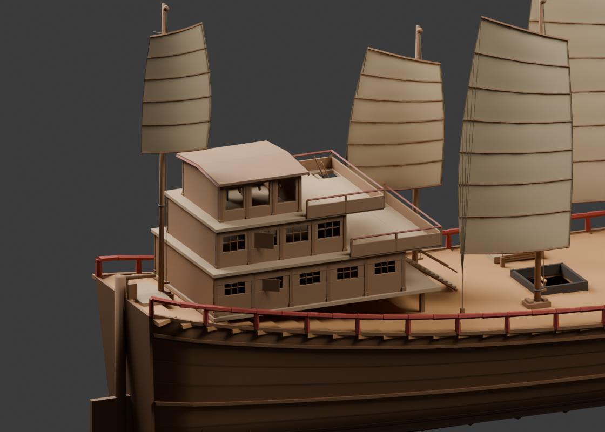
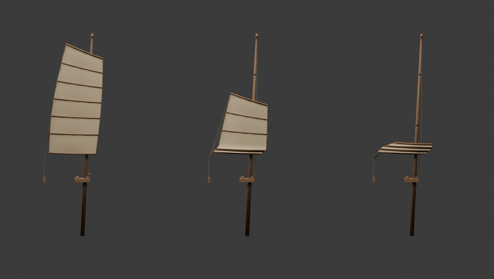
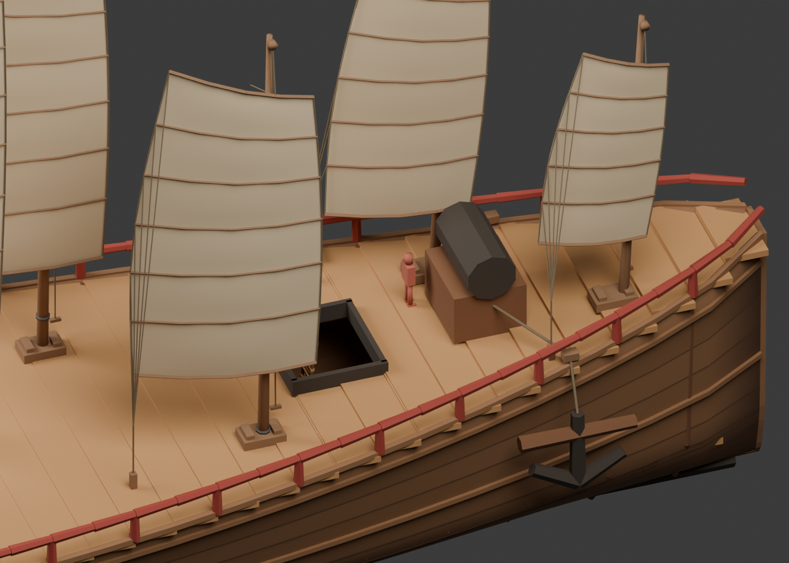
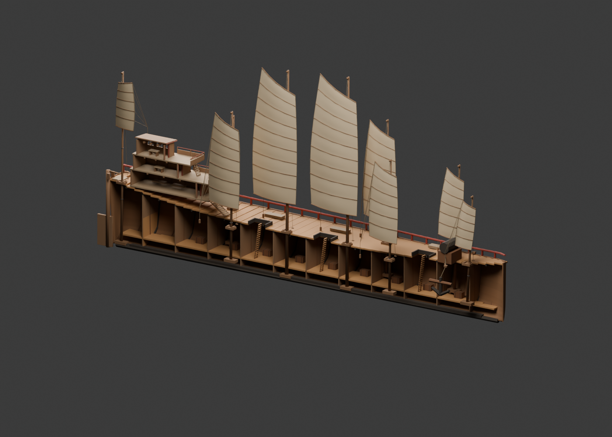

# 宝船船楼、帆装与操作空间调整

日期：2026-11-05。对象：二千料尺度的独立 Blender 母版，形制修订 3。

本轮直接编辑母版的构件树，保留参数底稿。先比较旧版、上层有窗遮蔽方案与上层开放方案，再选择有窗方案深化。三层船楼、九桅九帆及其尺寸仍是展示假设。

## 依据与采用范围

| 资料 | 可以支持的比较 | 本轮没有据此推定的内容 |
| --- | --- | --- |
| [《古今图书集成·戎政典》大福船图说](https://www.shidianguji.com/zh/mid-page/7597182380151406602) | 清代汇编记艉楼、护板、露台和穴梯；可比较围护与上下交通。 | 不能把二桅福船的描述视为永宣宝船图纸；不把船内四层解释成甲板上四层。 |
| [Science Museum Group 福州海船模型，1936-347](https://collection.sciencemuseumgroup.org.uk/objects/co41975/rigged-model-of-a-foochow-junk) | 馆藏表现20世纪初福州海船，主帆、首帆、艉帆分别编目，支持按用途比较大小帆。 | 不直接移植桅数、具体帆形、装饰或尺寸。 |
| [Science Museum Group 山东五桅商船，1933-670](https://collection.sciencemuseumgroup.org.uk/objects/co41902/model-of-a-5-masted-shantung-trading-junk) | 馆方明确记矩形帆、密帆骨、多支控帆索，也记中线与偏置桅并存。 | 中式帆形并非只有斜顶一种；此北方船型不能证明宝船的帆型或无支索结构。 |
| [《天工开物·漕舫》](https://zh.wikisource.org/zh-hant/天工開物/漕舫) | 晚明漕船记分片篷、竹条与逐片减帆，可比较帆骨叠合的原理。 | 不据此确定宝船的帆材、具体索路、收帆顺序或所需人数。 |
| [泉州市文旅局对宋代海船残体的介绍](https://www.quanzhou.gov.cn/zfb/xxgk/zfxxgkzl/qzdt/qzyw/202402/t20240204_3002556.htm) | 尖头方尾、尖底和多层船板为船体构造的类型参照。 | 残体不提供郑和船楼与帆装；本模型160毫米船壳、120毫米隔舱和艉部尺寸是设计选择。 |
| [长荣海事博物馆郑和宝船](https://www.evergreenmuseum.org.tw/collection/79) | 馆方说明其模型来自现代研究推论，九桅十二帆配约140米方案。 | 不把该帆装与本项目61.2米尺度拼接成已确定结论。 |

## 比例对照与选定方案

三个图使用相近的船楼检查视角。两种新方案共用逐层向艉退让的体量，区别在于上层开敞程度；选定有窗方案，是为了区分遮蔽舱室与前部工作露台，并非认为它的历史证据更强。

| 旧版 | 有窗遮蔽上层（采用） | 开放上层（对照） |
| --- | --- | --- |
|  |  |  |

下层围壁较封闭，设卧铺；中层示意工作室与前露台；上层为有窗遮蔽空间，顶设浅拱木屋面。层高分别为2.20、2.12、2.08米；房间功能、窗格、层高和屋顶曲线均为建模假设。保留两处真实梯口，取消第三层屋顶的连续阳台栏杆。梁端斜撑、纵向承托、柱脚与桅座楔木让连接关系可读。

## 帆装与收帆示范

两根主要高桅回到中线，并避开舱口；首、艉及侧部辅帆缩小。九面帆分为5、6、7、9幅等组合，上帆杆斜度、后缘和帆肚分别调整。每幅帆骨尾端有控帆支索。采用斜顶轮廓是一种研究性表现，未将矩形帆判为错误。

前部一面辅帆保留三套完整的布面、帆骨、升帆索和控帆索位置，网页只显示当前状态。帆骨下落后保持间距，布面在下部叠合，升帆索连接下降后的上帆杆，控帆支索仍接各帆骨尾端。

这是离散运动位置示范，没有求解绳长守恒、滑轮倍率、松索收纳、风载或织物受力，也没有验证帆面积与船舶稳性。不得把切换效果称为可实际操纵的动力学复原。

## 船体与空间检查

- 拓宽既有方艉封板，并连续调整附近船壳、护舷材与甲板轮廓；海面避让轮廓同步修改。船壳与隔舱补出实际厚度。
- 旧绞盘占用前舱口上方，现已向船首移动；锚缆经舷侧导缆点引入。舱口盖改成三片靠舷叠放，移除旧的整块盖板。
- 舵杆上端移至艉部甲板上方，增设短舵柄、舵承与站立平台；尚未核算操舵机械增益或升降机构。
- 母版保留四个1.70米人体参照，默认隐藏且不输出网页。检查主通道、绞盘、登楼入口与操舵位；通道/操作位的检查宽度分别按0.70米、0.65—0.82米的模型目标设置，不引申为安全标准。
- 主甲板至绞盘操作位采用34处采样。两段陡梯按每级踏步上方0.80—1.70米的上身体积检查，肩宽0.48米、前后厚0.30米，允许脚腿接触踏步。此项不是完整人体运动或整船通行认证。

## 材质、导出与验证

木构纹理随构件长向展开；部分木构倒角和帆面织物细节通过独立UV烘焙到1024×1024法线图与颜色图，均嵌入GLB。完整/剖视分别烘焙260与186个对象。程序材质、烘焙副本和网页产物不会反写母版。船壳端面、细绳纤维和更细致的使用痕迹还未全部展开。

网页完整模型29,626三角面、剖视21,898，包含三种示范状态的全部几何，均低于30,000；实际只显示一个收帆状态。母版求值总数为76,442与56,042，包含隐藏的研究构件。适配器共55个材质批次，未将其当作帧率测量。

几何检查覆盖原有尺度、门洞、梯口、帆面净空，并扩展到舱口上方全部构件、操作空间、通路采样、攀梯上身净空，以及三种状态下实际索端与帆骨连接、帆面高度递减和显示互斥。来源指纹、纹理内嵌与UV检查继续执行。完整的运行结果追加在 [FLEET-VALIDATION.md](FLEET-VALIDATION.md)。

本轮编辑脚本 `tools/blender/refine-baochuan-forms.py` 只用于从第2版母版制作研究副本，拒绝覆盖输入，且不会由正常导出调用。日常精修仍打开 `models/baochuan/baochuan-master.blend`，保存后按 [母版工作说明](../models/baochuan/README.md) 导出。参数底稿保留为先前构造基线，不能用于覆盖当前精修成果。
