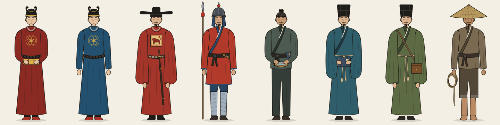
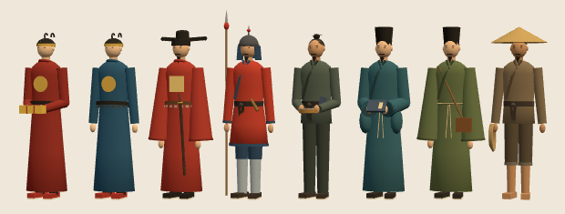

# 人物复原：需求表与详细要求（D）

本文是 [`ROADMAP.md`](ROADMAP.md) 中 D 部分（人物复原）的需求清单和逐项要求，供接手的人分步完成。接口、样式的总约定见 [`SPEC.md`](SPEC.md) §6、§7.4、§7.5、§8；两处冲突时以本文为准，同时改 SPEC。

时代限定：**1405—1433 年（永乐三年至宣德八年）**。优先用永乐、宣德及以前的材料；万历以后的图像只作旁证，并在 `src` 里注明年代。

---

## 0 现状：可用也可弃的草稿

交接前已做了一版草稿，用来验证"同一份参数同时生成 2D 立绘和 3D 人物"这条路走得通。草稿没有接入任何页面（`js/nav.js` 里 `people` 仍是 `ready: false`），可以整体替换，只要保持 §5 的接口。

| 文件 | 内容 | 状态 |
|---|---|---|
| `js/people-data.js` | `ZH_PEOPLE`：八类角色的身份、职责、服饰部件、配色、说明与出处 | 草稿，出处待逐条核对（§6） |
| `js/figure2d.js` | `ZHFigure.svg(role, { annotate })`：由部件参数生成正面立绘 SVG，可带引线标注或编号 | 草稿，画风可整体替换 |
| `three/figures.js` | `buildFigure(roleId, { lod })`、`disposeFigure(group)`：低多边形 3D 人物 | 草稿，lod 0 平均约 3,500 三角面 |
| `people.html` | 人物页 | 未开始 |

草稿效果（左起：正使太监、副使太监、都指挥、旗军、火长、通事、医官、水手）：





---

## 1 需求总表

优先级：**必须**（人物页上线的条件）· **应该**（上线后尽快补）· **可选**。

| 编号 | 需求 | 产出 | 优先级 | 依赖 | 验收标准 | 状态 |
|---|---|---|---|---|---|---|
| P1 | 核定角色与服饰依据 | `js/people-data.js` | 必须 | — | 八类角色字段齐全（§5）；每条服饰都有出处，或明确写"示意"；§6 中没有剩下的"待核"，或已改写为"一说" | 草稿 |
| P2 | 2D 正面立绘 | `art/people/<id>.svg`，或由 `ZHFigure` 生成 | 必须 | P1 | 符合 §4.1；八张图同一比例，可以并排 | 草稿 |
| P3 | 部件标注 | 立绘上的引线标注（宽屏）与编号（窄屏） | 必须 | P2 | 标注文字取自 `costume[].name`；点标注能定位到对应说明，反之亦然 | 草稿 |
| P4 | 3D 人物 | `three/figures.js` | 必须 | P1 | 符合 §4.2；三角面在预算内；每个网格都有 `userData.part` | 草稿 |
| P5 | 人物页 | `people.html`、`css/people.css`、`three/people-page.js` | 必须 | P2—P4 | 符合 §4.3；桌面、手机、昼夜四种截图检查通过 | 待办 |
| P6 | 群像对照 | 人物页中"群像"视图（2D、3D 各一） | 应该 | P2 P4 | 八人同一比例并排，旁附 1 米比例尺 | 待办 |
| P7 | 宝船甲板上的人物 | 舰队页单船视图中的人物 | 应该 | P4、舰队 C5 | 符合 §4.4；由舰队页维护者合入 | 待办 |
| P8 | 作战装束 | 都指挥、旗军的甲胄版本 | 可选 | P1 | 甲胄形制有明初依据；不用罩甲等后出样式（§3.3） | 待办 |
| P9 | 背面视图 | 补子背面、帽后曲脚、袍服后摆 | 可选 | P2 | 与正面同一比例与画风 | 待办 |
| P10 | 扩展角色 | 阴阳官、书算手、办事、舍人、匠作（铁锚、木艌、搭材）、民梢 | 可选 | P1 | 名目见《前闻记》；无专门服饰记载的标"示意" | 待办 |
| P11 | 构建与检查 | `tools/build.mjs`、`tools/check-build.mjs`、新增 `tools/check-people.mjs` | 必须 | P5 | 符合 §7；`npm run check` 与 `npm run build` 通过；离线 `dist/people.html` 可用 | 待办 |

---

## 2 角色总表（核心八类）

| `id` | 名称 | 人物实例 | 品级或身份 | 冠帽 | 袍服 | 补子 | 腰带 | 靴鞋 | 器物 |
|---|---|---|---|---|---|---|---|---|---|
| `eunuch-envoy` | 正使太监 | 郑和、王景弘 | 内官监太监（正四品） | 乌纱描金曲脚帽 | 盘领窄袖衫 | 胸背花 | 乌角带 | 红扇面黑下桩靴 | 诏敕 |
| `eunuch-deputy` | 副使太监 | 朱良、周满、洪保、杨真、张达、吴忠 | 太监、少监 | 同上 | 同上 | 同上 | 同上 | 同上 | — |
| `commander` | 都指挥 | 朱真、王衡 | 都指挥使（正二品）等 | 乌纱帽（展角） | 团领衫 | 狮子补 | 花犀带 | 皂靴 | 腰刀 |
| `soldier` | 旗军 | 随船官军的主体 | 卫所军士 | 铁盔（示意） | 红胖袄 | — | 布带 | 裹腿、布鞋 | 长枪、手铳 |
| `pilot` | 火长 | — | 无品级，民间船师 | 网巾 | 短衣长裤 | — | 布带 | 布鞋 | 水罗盘、针簿 |
| `interpreter` | 通事 | 马欢、郭崇礼 | 无品级 | 四方平定巾 | 直身 | — | 丝绦 | 布鞋 | 簿册 |
| `physician` | 医官 | 医官、医士 | 医官、医士 | 四方平定巾 | 直身 | — | 丝绦 | 布鞋 | 药箱 |
| `sailor` | 水手 | 水手、舵工、班碇手 | 无品级 | 斗笠 | 短褐 | — | 布带 | 赤足 | 缆绳 |

人数线索：祝允明《前闻记》记第七次下西洋的人员名目为"官校、旗军、火长、舵工、班碇手、通事、办事、书算手、医士、铁锚、木艌、搭材等匠、水手、民稍人等"，共二万七千五百五十员名。名目本身就是角色清单的依据；各类人数除总数外不见于此记。

---

## 3 各角色的详细要求

每个角色分三部分：**必须表现**、**不要出现**、**待核**。"待核"做完后，把结论写进 `costume[].note` 和 `src`，并更新 §6。

### 3.1 正使太监 `eunuch-envoy`

- **必须表现**：明初内使冠服四件：乌纱描金曲脚帽、胸背花盘领窄袖衫、乌角带、红扇面黑下桩靴（《明史·舆服志》内使冠服条）。不蓄须。双手捧诏敕匣，以黄绢包裹（出使宣读诏敕；巩珍《西洋番国志》卷首录有敕书）。
- **不要出现**：写实相貌。郑和没有同时代的画像传世；袁忠彻《古今识鉴》中"身长九尺，腰大十围"一类描写是相术家的夸饰，不能作为造型依据。蟒衣、飞鱼服也不要画，这类赐服不见于郑和本人的记载。清代元素一概不要，例如马蹄袖、顶戴、对襟补服、辫发。
- **待核**：盘领窄袖衫的剪裁（下摆是否打褶，即是否作曳撒式）；胸背花的纹样。可以对照宣德年间商喜《明宣宗行乐图》（故宫博物院藏）中内侍的装束，这幅画与第七次下西洋同时代。

### 3.2 副使太监 `eunuch-deputy`

- **必须表现**：与 3.1 相同的内使冠服。用颜色区分正副使，但要在说明里写明颜色只是示意。
- **人物实例**：长乐《天妃灵应之记》碑列副使太监朱良、周满、洪保、杨真、张达、吴忠。洪保墓 2010 年在南京祖堂山发现，墓中《大明都知监太监洪公寿藏铭》可以说明副使出自不同的内府衙门。
- **不要出现**：同 3.1。

### 3.3 都指挥 `commander`

- **必须表现**：官员常服，即乌纱帽、团领衫、束带。补子和腰带都按品级画：洪武二十四年定制，武官一、二品用狮子，三、四品用虎豹；腰带一品用玉，二品用犀，三、四品用金。都指挥使是正二品，都指挥同知是从二品，都用狮子补、犀带；都指挥佥事是正三品，应改为虎豹补、金带。所以画之前要先定下画的是哪一级。佩腰刀。
- **作战装束（P8，可选）**：明初甲胄以甲片编缀的札甲为主。
- **不要出现**：罩甲（正德年间才出现）、戏曲舞台上的靠旗与盔头、清代的箭衣和马蹄袖。
- **待核**：永乐年间补子的实际使用和纹样。洪武有定制，但传世实物和画像多是明中后期的，早期形象要谨慎。

### 3.4 旗军 `soldier`

- **必须表现**：胖袄，"长齐膝，窄袖，内实以棉花"，以红色为主（《明史·舆服志》军士条）。下穿裤，裹腿，穿布鞋或草鞋。兵器用长枪、腰刀、弓箭、手铳；明初铜手铳有洪武、永乐年款的实物传世。船上的火器还可以加碗口铳。
- **不要出现**：鸟铳（嘉靖年间才传入）、佛郎机（正德末传入）、藤牌兵与狼筅（戚继光时代），也不要画清代号衣。
- **待核**：明初军士常戴的头盔或帽笠形制。草稿画的是圆顶铁盔加护耳，只是示意。另外"鸳鸯战袄"的说法要查到出处。

### 3.5 火长 `pilot`

- **必须表现**：民间船师的装束，网巾束发，短衣长裤，便于在甲板上行动。手持水罗盘：木盘盛水，磁针浮在水面上；细节版的盘面画二十四向。腰间插针簿。巩珍《西洋番国志·自序》说，火长是从驾船民梢中挑选"经惯下海者"充任，用作船师，再把"针经图式"交给他掌管。
- **可加的器物**：牵星板（《郑和航海图》附有"过洋牵星图"），以及计更用的更香。
- **不要出现**：旱罗盘（明后期才传入），也不要画西式星盘、六分仪。

### 3.6 通事 `interpreter`

- **必须表现**：一般士人的装束，即四方平定巾（洪武三年定）、直身、丝绦。持簿册。
- **人物实例**：马欢，浙江会稽人，回族，通晓阿拉伯语，随第四、六、七次下西洋，著《瀛涯胜览》。郭崇礼，杭州仁和人，同为通事。费信原是太仓卫军士，著《星槎胜览》。
- **注意**：除非找到依据，不要给马欢画伊斯兰宗教服饰。

### 3.7 医官 `physician`

- **必须表现**：四方平定巾、直身、丝绦，背药箱。
- **待核**："医官医士一百八十名"出自《郑和家谱》，史源较晚，只能作"一说"。《前闻记》的名目中有"医士"。随行医士的名字（例如匡愚）可以补进 `example`，但要注明出处。

### 3.8 水手 `sailor`

- **必须表现**：斗笠、短褐、卷起裤腿、赤足，手拿缆绳。这一类可以再分出舵工（掌舵柄）和班碇手（起落碇、锚）两个变体。
- **说明**：水手装束没有专门的记载，按明代劳动者的一般形象画，整套标"示意"。

---

## 4 详细要求

### 4.1 2D 立绘

- **画布**：`viewBox="0 0 240 480"`，脚底在 y = 460，头顶约 y = 45（不含冠帽）。八个角色用同一比例，不要单独放大哪一个。
- **姿态**：正面站立。可以侧转 15° 以内，但同一组图要统一。手持器物的角色可以双手在胸前或腰前。
- **线条**：外轮廓 1.6 px，内部褶线 0.8 px，墨色固定为 `#211c17`。
- **上色**：平涂，不用渐变和照片质感；阴影最多用同色加深一档。颜色只取角色 `palette`。夜间模式只换背景、标注线和标注文字，不改服饰本色。
- **面部**：极简示意（眉、眼、鼻各一笔），不画具体相貌，不画夸张表情。
- **标注**：宽屏用引线把标注拉到两侧（画布扩成 `-150 0 540 480`），窄屏改用编号圆点，说明列在图下。标注文字用 `--f-ui` 12 px。每个标注元素带 `data-part`（部件）和 `data-i`（在 `costume` 中的序号）。
- **手绘文件**（如果不用生成器）：存为 `art/people/<id>.svg`，不嵌字体，不引用外部图片；部件分组写成 `<g id="part-hat">` 这样，便于页面高亮。每张不超过 40 KB。

### 4.2 3D 人物

- **接口**：`buildFigure(roleId, { lod })` 返回 `THREE.Group`；`disposeFigure(group)` 释放几何体和材质。
- **坐标**：1 单位 = 1 米，脚底 y = 0，面向 +Z，人物左手一侧为 +X。身高（不含冠帽）1.65—1.70 米。
- **部件**：每个网格都有 `userData.part`，取值见 §5，用于点击查看。Group 的 `userData` 含 `role`、`name`、`height`、`lod`。
- **三角面预算**：lod 0 ≤ 8,000；lod 1 ≤ 2,000；lod 2 ≤ 400。lod 2 在船上一次要放几十到上百人，要能合并成 InstancedMesh，每人材质数不超过 6 种。
- **材质**：用 `MeshStandardMaterial`，颜色取 `palette`。默认不用贴图；补子纹样可以选用一张 256×256 的贴图。
- **用 Blender 建模（可选）**：导出 `assets/people/<id>.glb`，每个不超过 300 KB，沿用同一套坐标和部件命名（节点名写成 `part:hat`）。`buildFigure` 先载入 GLB，失败时退回参数化模型，做法参照 `three/blender-ships.js`。离线构建时，GLB 要像宝船模型那样内嵌。

### 4.3 人物页 `people.html`

- **结构**：页眉导航与其他页面一致（`js/nav.js`）。内容分三栏：左侧是角色列表（八个缩略立绘），中间是人物（2D、3D、群像三种视图切换），右侧是说明（名称、实例、品级、职责、服饰逐条说明及出处、注意事项）。
- **联动**：点立绘上的标注或 3D 部件，右侧对应条目高亮并滚动到可见处；点右侧条目，人物上对应部件高亮。全部操作可以用键盘完成。
- **地址**：`people.html#role=pilot&view=3d`，`view` 取 `2d`、`3d`、`lineup`。
- **3D 视图**：用 import map 载入 three.js（SPEC §1.3），配 OrbitControls，视点对准 y ≈ 0.95，限制缩放范围。右下角固定显示"示意复原"和 1 米比例尺（SPEC §7.5）。WebGL 不可用时自动退回 2D。
- **窄屏（≤ 860 px）**：改为单栏；立绘改用编号标注；3D 视口高 60svh。
- **昼夜**：响应 `zh:theme` 事件。
- **上线**：去掉 `js/nav.js` 中 `people` 的 `ready: false`。

### 4.4 宝船甲板上的人物（P7）

舰队页由另一位维护者负责，这一项只提要求，由对方合入：

- 用 lod 2，按甲板高度或 `ship.userData.anchors` 摆放；替换 `three/fleet-page.js` 中 `reference()` 里的圆柱人形。
- 只在单船近景显示，近景宝船上 20—60 人；舰队远景不显示人物。
- 加入人物后，手机上的帧率不低于原来的 90%。

---

## 5 数据格式 `ZH_PEOPLE`

```js
window.ZH_PEOPLE = {
  sources: { yufu: '《明史·舆服志》', ... },        // 常用出处简称
  note: '还原的是职官与身份的典型服饰……',
  roles: [{
    id: 'eunuch-envoy',                             // §2 中的 id
    name: '正使太监', example: '郑和、王景弘', rank: '内官监太监（正四品）',
    duty: '统领全军，宣读诏敕……',
    figure: {                                       // 2D 与 3D 共用的部件参数
      hat: 'quji',      // quji 曲脚帽 | wusha 乌纱帽 | sifang 四方平定巾 | wangjin 网巾 | helmet 盔 | douli 斗笠
      robe: 'round',    // round 圆领长袍 | cross 交领长衫 | jacket 短衣 | pangao 胖袄
      sleeve: 'narrow', // narrow | wide
      badge: 'flower',  // null | 'lion' | 'flower'（新增纹样时同步加到两个生成器）
      belt: 'horn',     // horn 乌角带 | rhino 花犀带 | sash 布带 | cord 绦
      feet: 'boots',    // boots | cloth | straw | bare
      legs: null,       // null（长袍遮住）| trousers | rolled | wraps
      beard: false,
      items: ['edict']  // edict compass book（持于身前）| sword spear gun medbox rope
    },
    palette: { robe, trim, hat, belt, boots, bootFace?, skin, item },   // '#rrggbb'
    costume: [ { part: 'hat', name: '乌纱描金曲脚帽', note: '……', src: '《明史·舆服志》' } ],
    caution: '郑和没有同时代的画像传世……',
    // 以下为可选字段
    variants: { armor: { figure: {...}, palette: {...}, costume: [...] } },  // P8 作战装束
    refs: [ { title: '《明宣宗行乐图》', holder: '故宫博物院', date: '宣德', note: '内侍装束' } ]
  }]
};
```

- `costume[].part` 取值：`hat` 冠帽 · `robe` 袍服 · `badge` 补子 · `belt` 腰带 · `boots` 靴鞋 · `armor` 甲胄 · `weapon` 兵器 · `item` 器物。
- 3D 网格的 `userData.part` 用同一套取值，另加 `body`（头、手、腿等身体部分）。
- `src` 必填：书名用《》，实物写"收藏地或出土地 + 名称"，没有依据的写"示意"。
- 新增 `figure` 取值时，要同时改 `js/figure2d.js`、`three/figures.js` 和本节。

---

## 6 史料核查表

草稿中的服饰依据多按通行引述整理，**都要对照原文核实**。核实后把状态改为"已核"，并写明卷次。

| 条目 | 依据 | 状态 |
|---|---|---|
| 内使冠服：乌纱描金曲脚帽、胸背花盘领窄袖衫、乌角带、红扇面黑下桩靴 | 《明史·舆服志》内使冠服条 | 待核原文 |
| 武官补子：一、二品狮子，三、四品虎豹（洪武二十四年） | 《明史·舆服志》；万历《大明会典》 | 待核原文 |
| 官员带制：一品玉、二品犀、三四品金 | 同上 | 待核原文 |
| 胖袄"长齐膝，窄袖，内实以棉花" | 《明史·舆服志》军士条 | 待核原文 |
| "鸳鸯战袄" | 出处待查 | 待核 |
| 四方平定巾，洪武三年定 | 《明史·舆服志》 | 待核原文 |
| 网巾，洪武年间推行 | 《三才图会·衣服》；郎瑛《七修类稿》 | 待核原文 |
| 第七次人员名目及二万七千五百五十人 | 祝允明《前闻记》 | 已用于航次档案（`js/voyages-detail.js`） |
| 火长选自民梢，掌针经图式 | 巩珍《西洋番国志·自序》 | 待核原文 |
| 出使敕书 | 巩珍《西洋番国志》卷首 | 待核原文 |
| 副使太监与都指挥名单 | 长乐《天妃灵应之记》碑 | 已用于航次档案 |
| 洪保为都知监太监 | 南京祖堂山洪保墓《大明都知监太监洪公寿藏铭》 | 待核 |
| 医官医士一百八十名 | 《郑和家谱》 | 史源晚出，作一说 |
| 马欢后任鸿胪寺序班 | 待查 | 一说 |
| 罩甲出现于正德年间 | 《明史·舆服志》 | 待核原文 |
| 鸟铳嘉靖年间传入，佛郎机正德末传入 | 通行研究 | 待核 |
| 洪武、永乐年款手铳与碗口铳实物 | 中国国家博物馆等收藏 | 待核 |
| 明代成年男子身高约 1.6—1.7 米 | 骨骼考古研究，一说 | 示意 |

---

## 7 参考资料

- **实物**：山东邹城鲁荒王朱檀墓（1389 年下葬）出土的冠服、乌纱帽，年代最接近。定陵等明后期墓葬只作旁证。
- **图像**：商喜《明宣宗行乐图》（宣德，故宫博物院），与第七次下西洋同时代；《出警入跸图》（万历）、《三才图会》（万历，图式化），年代较晚，要慎用。
- **研究**：沈从文《中国古代服饰研究》、周锡保《中国古代服饰史》、孙机《华夏衣冠》。

---

## 8 验收与检查

1. **`tools/check-people.mjs`**（待写，加入 `npm run check`），检查以下各项：
   - 每个角色字段齐全，枚举值合法，颜色都是 `#rrggbb`；
   - 每条 `costume` 都有 `src`，每个角色都有 `caution`；
   - 在 Node 中对每个角色调用 `buildFigure`，lod 0、1、2 都不超过三角面预算，每个网格都有 `userData.part`；
   - `ZHFigure.svg` 对每个角色都能生成，且标注数与 `costume` 中有锚点的部件数一致。
2. **构建**：`tools/build.mjs` 的页面列表和 Artifact 复制列表加上 `people`；`tools/check-build.mjs` 加上 `people`。
3. **截图**：桌面 1440×900、手机 390×844，昼夜各一张。控制台无报错，页面无横向滚动。
4. **离线**：`dist/people.html` 用 `file://` 打开，2D 与 3D 都能显示。
5. **文档**：更新 ROADMAP D 行的状态；格式有变动的，同步改本文 §5 和 SPEC §6。
