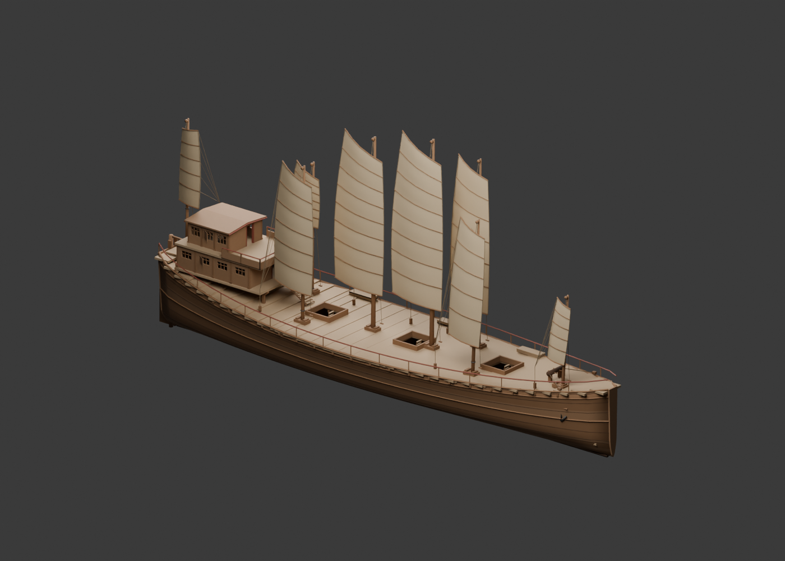
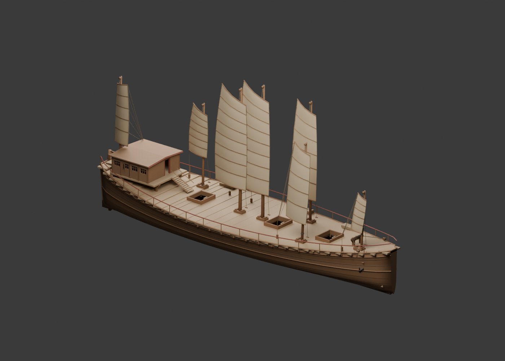
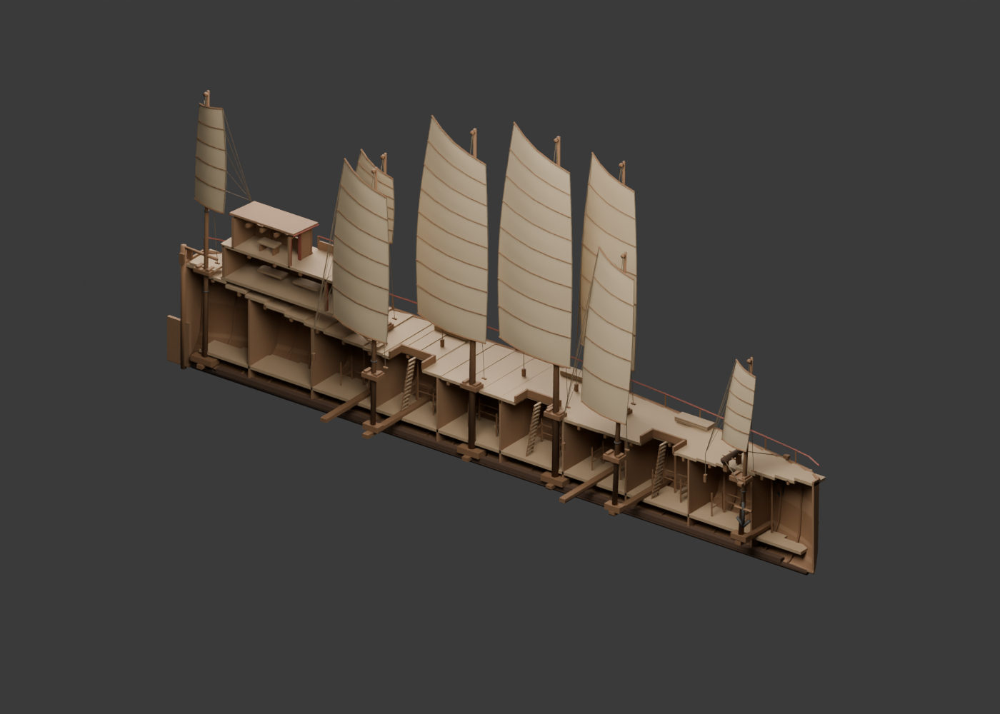
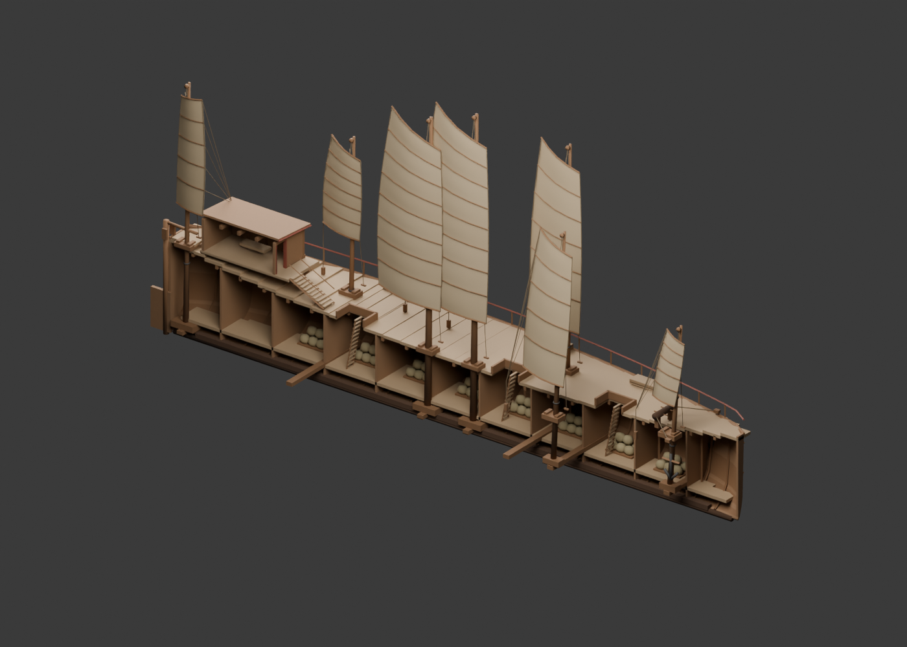
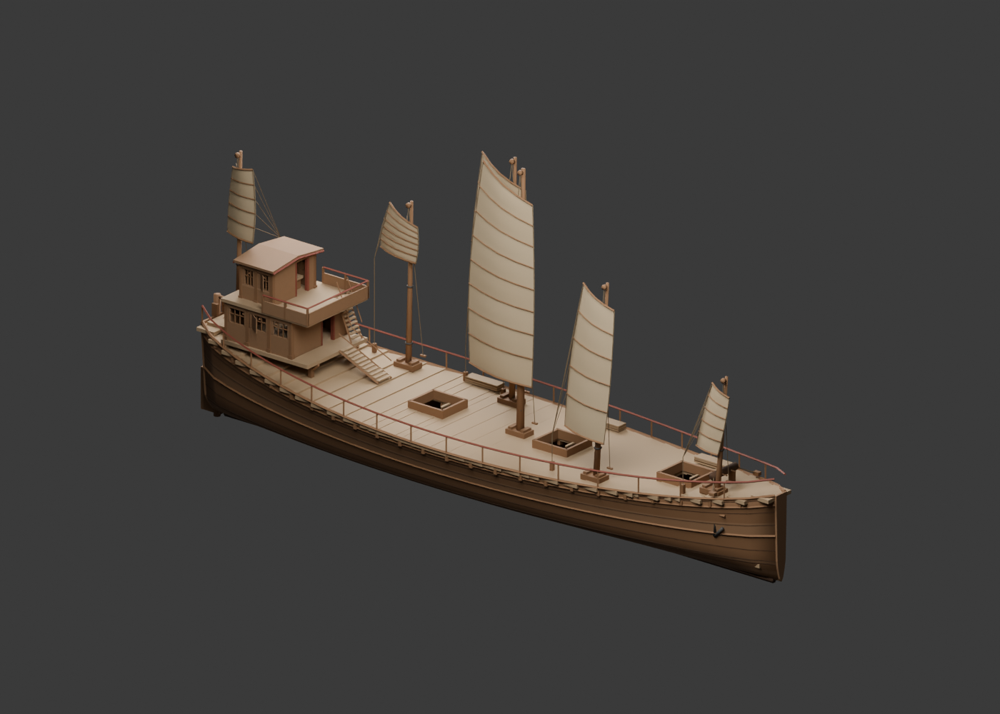
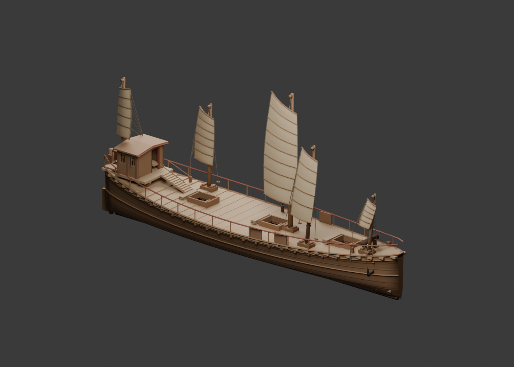
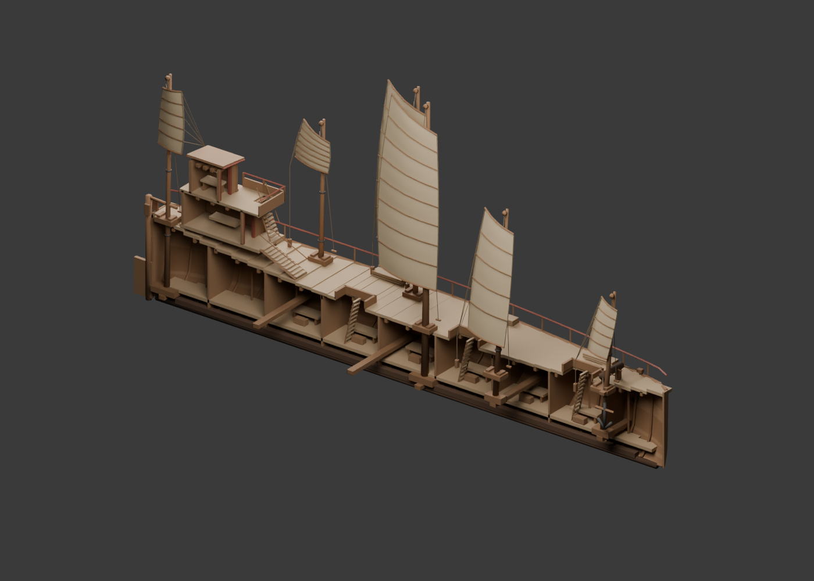
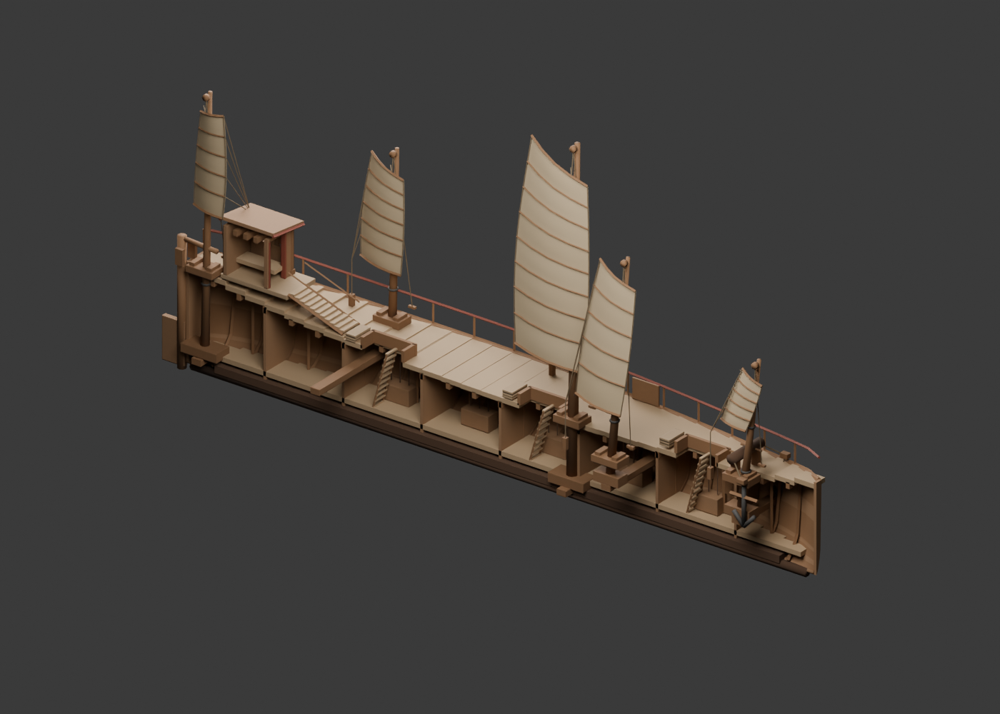

# 五类船的 Blender 母版

五类船均有独立母版、参数底稿及完整/剖视网页产物。宝船保留2026-11-05的第3版精修；其余四类于2026-11-06开始重建，并在2026-11-09完成导出、来源保护、自动验收及最终离线页的 HTTP 浏览器验收。验收范围、截图与边界见[验收记录](../docs/FLEET-VALIDATION.md)。尺寸、桅数与用途布局的证据等级见[本轮记录](../docs/FLEET-REBUILD-2026-11-06.md)。

| 船型 | 精修母版 | 形制与用途 |
| --- | --- | --- |
| 宝船 | [baochuan-master.blend](baochuan/baochuan-master.blend) | 61.2×13.8米，三层艉楼，九桅九帆 |
| 马船 | [machuan-master.blend](machuan/machuan-master.blend) | 49×11.5米，两层艉楼，八桅，空马栏与饲槽 |
| 粮船 | [liangchuan-master.blend](liangchuan/liangchuan-master.blend) | 43×11.8米，一层艉楼，七桅，垫板与粮袋 |
| 坐船 | [zuochuan-master.blend](zuochuan/zuochuan-master.blend) | 37×8.8米，两层艉楼，六桅，卧铺与储物箱 |
| 战船 | [zhanchuan-master.blend](zhanchuan/zhanchuan-master.blend) | 30×6.8米，一层艉楼，五桅，侧部盾板与器械柜 |

除宝船的二千料研究解释外，表中四类船尺寸为本项目既有的用途比例假设，不能作为原船测量值。所有船型的帆装、舱楼及载运能力均未得到工程验证。

## 编辑和导出

直接打开表中的母版编辑。全船与剖视分别位于 `<Ship>_full`、`<Ship>_section` 集合，保留六个带 `part` 属性的构件组。共同构件需在两棵树中同步编辑；不得删除根对象的 `metadata`。造型改变后同步相应布局信息，让开孔和净空检查仍能定位实际构件。

母版无三万面限制；网页每份模型必须低于30,000三角面，包含三种收帆状态的全部几何。`DETAIL_` 修改器只保留于母版并按标记烘焙，`WEB_` 仅导出时启用，其他修改器作为造型保留。木构倒角与帆材的颜色、法线图由导出器嵌入GLB。

| 船型 | 网页完整/剖视三角面 | 母版完整/剖视三角面 | 材质批次 |
| --- | ---: | ---: | ---: |
| 宝船 | 29,626 / 21,898 | 76,442 / 56,042 | 55 |
| 马船 | 23,628 / 17,340 | 58,844 / 44,812 | 46 |
| 粮船 | 24,624 / 18,736 | 47,584 / 37,472 | 47 |
| 坐船 | 20,840 / 14,704 | 51,336 / 38,864 | 46 |
| 战船 | 18,836 / 13,044 | 37,780 / 28,820 | 47 |

批次数为完整与剖视各自的相同实测值，不是跨设备帧率指标。网页三角面包含当前三种收帆姿态的全部几何，显示时只启用一种。

例如修改马船后：

```sh
npm run model:export -- --ship machuan
npm run model:render -- --ship machuan
npm run model:check -- --ship machuan
npm run check
npm run build
```

命令省略 `--ship` 时继续处理宝船；`--ship all` 依次处理五类船。`model:init-master` 遇到已有母版会报错，不会覆盖精修。

```sh
npm run model:all
```

这条命令重建五类参数底稿，只为缺失的母版执行初始化，然后从各自已保存的母版导出、渲染。**重建底稿不会把已有母版退回参数版本。** 若母版已存在，建模脚本的新改动需先制作研究副本、检查后再明确采用；正常导出不会执行造型修改。

底稿位于各船目录的 `generated/`，检查图位于 `previews/`，网页GLB和贴图位于 `assets/ships/`。每船报告记录母版指纹和产物指纹，构建拒绝过期、缺失或测试专用的导出。

## 检查图与状态

下列图像用于观察实际母版或派生GLB的形体；它们不是原船史料图。网页加载、离线包与浏览器验收的最终状态记录在 [FLEET-VALIDATION.md](../docs/FLEET-VALIDATION.md)；最终离线页截图见 [web-final](previews/fleet-2026-11-09/web-final.png)、[web-section](previews/fleet-2026-11-09/web-section.png) 与 [web-mobile](previews/fleet-2026-11-09/web-mobile.png)。

| 马船 | 粮船 |
| --- | --- |
|  |  |
|  |  |

| 坐船 | 战船 |
| --- | --- |
|  |  |
|  |  |

宝船的体量对照和收帆研究图见[既有精修记录](../docs/BAOCHUAN-FORMS-2026-11-05.md)。
